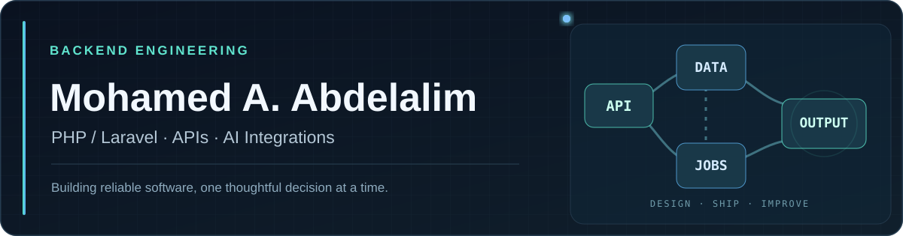

 

  
  
  
  

## About my repositories

> **Most of my professional and independent project work is kept in private repositories** because the source code is not intended for public distribution. My public repositories are primarily learning experiments, technical tests, and small prototypes—not a complete representation of my production experience. The **Selected work** section below highlights projects and engineering contributions I can discuss without disclosing private code.

## About me

I'm **Mohamed Ahmed Abdelalim**, a backend-focused software developer specializing in **PHP and Laravel**. My software development journey started in **2020**, building full-stack freelance projects before moving into production applications and collaborative engineering teams.

At **MediaPanArab**, I work as a **Senior PHP/Laravel Developer** and take on **technical lead responsibilities**—contributing to feature planning, reviewing code, coordinating development work, and monitoring production applications.

I enjoy making existing systems better: investigating inefficient database queries, designing focused APIs, moving expensive operations to background jobs, and building AI-assisted tools that fit real editorial workflows.

## What I work on

| Focus | Experience |
| :--- | :--- |
| **Backend & APIs** | Laravel applications, REST APIs, application security, production maintenance, and API response optimization |
| **Performance & Data** | Eloquent query optimization, N+1 fixes, SQL, file/database caching, and queue-based background processing |
| **Real-time Sports** | Sports data integrations and Firebase-powered notifications for live football match events |
| **Applied AI** | Gemini API integration, prompt engineering, AI-assisted editorial workflows, and news-grounded quiz generation |
| **Team Collaboration** | Code reviews, task coordination, technical discussions, feature testing, and knowledge sharing |

## Selected work

### AI Editorial Assistant · End-to-end feature

Built an AI-powered editorial review feature **from scratch**, including the backend and editor-dashboard frontend. The assistant uses the **Gemini API** and football-news-specific prompts to flag spelling issues and propose writing improvements. Editors stay in control: they can review suggestions side by side, apply individual changes, or choose to apply all suggested revisions.

### AI-powered Sports Quiz Generator · End-to-end feature

Built a full-stack quiz creation and management feature integrated into an **existing** points-and-rewards platform. Editors select a football competition, date range, and relevant news articles; Gemini generates news-grounded questions at **easy, medium, and hard** difficulty levels. Refined prompts to improve relevance and reduce generation errors. *The existing rewards engine was not part of this build.*

### News & Live Sports Platforms · Production engineering

Maintain and improve existing news and sports backend systems, including editorial workflows, sports-data APIs, and live match features. Work includes **database query optimization**, short-lived caching for frequently changing content, **asynchronous jobs** for recurring updates, and Firebase match-event notifications.

> Most of this work is proprietary. These descriptions focus on my contributions without sharing internal architecture, private metrics, or confidential implementation details.

## Toolbox

**Core backend**

**Additional technologies**

**AI & current learning**

I have studied **C#, ASP.NET Core Web API, and Entity Framework Core** and am building practical experience in the .NET ecosystem. My professional production experience remains primarily **PHP/Laravel**.

## Engineering principles

- **Measure before optimizing.** Fix real bottlenecks instead of adding unnecessary complexity.
- **Keep APIs intentional.** Return what consumers need and avoid wasteful database access.
- **Design for change.** Balance fresh content, caching, queues, and operational reliability.
- **Use AI responsibly.** Keep editorial oversight and human approval in the workflow.
- **Review, document, share.** Good engineering is collaborative.

---

**Interested in collaborating or discussing a remote backend role?**

<a href="https://www.linkedin.com/in/abdelalim1997/"><strong>Let's connect on LinkedIn</strong></a>
&nbsp;·&nbsp;
<a href="https://github.com/abdelalim2000?tab=repositories"><strong>Explore my repositories</strong></a>

  

Backend engineering · Laravel · Performance · Applied AI

